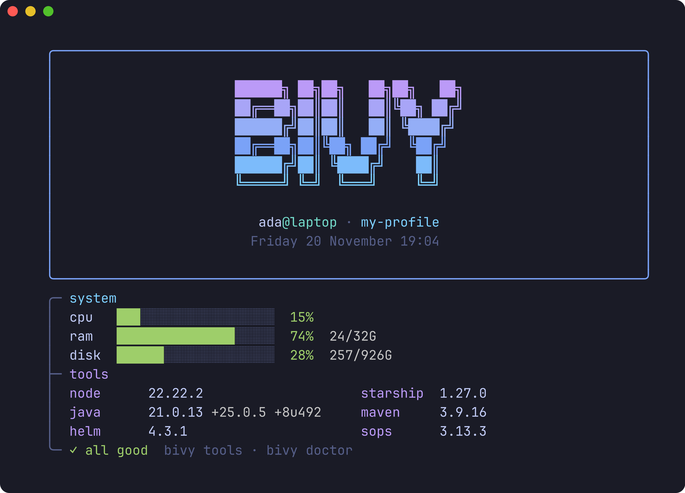

# povy

A portable development environment for macOS, Linux and Windows, through WSL2 or, in
preview, natively in PowerShell 7.

povy keeps your real `HOME`. Tools come from [mise](https://mise.jdx.dev), and their
shims are on `PATH` in interactive and non-interactive shells alike, and in graphical
apps, so IDEs and coding agents see the same tools, SSH keys and config files you do.

<p align="center">
  
</p>

```bash
curl -fsSL https://raw.githubusercontent.com/Yodatek/povy/main/bootstrap | bash
```

The bootstrap installs Git and mise if they are missing, clones the engine into
`~/.local/share/povy` and links the command at `~/.local/bin/povy`. On a terminal it
then offers to configure the machine.

To update povy, run the same command again, then `povy apply`. The
[changelog](CHANGELOG.md) lists what each release changes, and `povy --version` tells
which one you run.

### Windows without WSL2 (preview)

In PowerShell 7:

```powershell
irm https://raw.githubusercontent.com/Yodatek/povy/main/bootstrap.ps1 | iex
```

This bootstrap installs Git and mise with winget if they are missing, clones the engine
into `%LOCALAPPDATA%\povy\engine` and adds the `povy` command to your user `PATH`. The
PowerShell engine reads the same `config.toml` and profiles, and offers `povy init`,
`apply`, `doctor` and `version`. What changes on Windows:

- The mise shims and the profile commands go on the user `PATH`, which every new
  process gets, graphical apps included. Windows puts the system `PATH` first, so a
  tool also installed for the whole machine wins outside PowerShell; `povy doctor`
  names it. PowerShell sessions put the shims first.
- Your PowerShell profile gets a marked block that sources the profile's `.ps1` shell
  files and starts the prompt.
- `[packages]` uses its `winget` list.
- Files with secrets are readable by you only, through their access list.
- There is no banner and no `povy tools` yet.

## Commands

| Command | What it does |
| --- | --- |
| `povy init` | Asks for a name, an e-mail and an optional profile URL. Writes `~/.config/povy/config.toml` and `.env` in mode 600, and opens `.env` in `$EDITOR` only if the profile needs secrets that are still empty. |
| `povy init --config <file>` | The same without questions or editor, from an existing `config.toml`. |
| `povy apply` | Installs the tools, puts the shims on the `PATH` of shells and graphical apps, sets the Git identity and writes the profile files. Running it again changes nothing. |
| `povy doctor` | Checks the real state and changes nothing. Exits 0 if all is well, 1 otherwise. |
| `povy banner` | Shows the tools, what does not work right now, and the CPU, memory and disk load. |
| `povy tools` | Lists each tool with the level that declares it (povy, profile or machine) and the version mise runs, including tools that your own mise config sets or overrides. |
| `povy version` | Shows the release povy is on, such as `0.1.0`, or `0.1.0-3-gabc1234` three commits after it. |

## Three levels

1. **The engine** is this repository. It holds nothing specific to a person or a company.
2. **A profile** is an optional, separate Git repository, usually private.
3. **The machine config** lives in `~/.config/povy/` and is never versioned.

```toml
# ~/.config/povy/config.toml
name = "Ada Lovelace"
email = "ada@example.org"
profile = "git@example.org:me/my-profile.git"
profile_branch = "main" # optional: a branch of the profile repository, else its default
profile_path = "povy"   # optional: the directory of the repository that holds profile.toml
prompt = "starship"     # optional: starship, or none to keep yours; overrides the profile

[tools]            # optional, overrides the profile
node = "22"

[[identities]]     # optional, another Git identity under a directory
dir = "~/oss/"
email = "ada@users.noreply.github.com"
# name = "Ada"     # defaults to the name above
```

## Git identity

`name` and `email` become your Git identity. Each `[[identities]]` entry replaces it in
the repositories under its directory, through `includeIf "gitdir:..."`. The directory
starts with `~/` or `/`.

povy includes its generated config from the top of your global Git config, so what you
wrote below keeps precedence. A `[user]` there wins over every identity povy sets, even
in an identity directory, so `apply` and `doctor` name the file that holds one.

## Profiles

A profile has a `profile.toml` at the root of its repository, or in the directory that
`profile_path` names. [_samples/profile](_samples/profile) uses every key, and its README
shows how to try it on a machine.

```toml
prompt = "starship"                 # optional, see Prompt
bin = "bin"                         # optional, commands put on PATH
shell = ["shell/aliases.sh", "shell/aliases.ps1"] # optional, sourced by interactive shells

[secrets]
required = ["EXAMPLE_API_TOKEN"]   # read from ~/.config/povy/.env

[tools]                             # any tool mise installs, see below
jq = "1.7.1"
java = ["21", "25"]                 # all installed, the first one is the default
"pipx:ansible-lint" = "26"          # a mise backend: pipx, npm, cargo, aqua, github...

[packages]                          # only what mise cannot install
brew = ["podman"]                   # macOS formulas
cask = ["iterm2"]                   # macOS apps
apt = ["podman"]                    # Debian, Ubuntu, WSL2
dnf = ["podman"]                    # Fedora, RHEL
winget = ["RedHat.Podman"]          # Windows

[[files]]
source = "files/example.conf.tmpl"          # relative to the profile
target = ".config/povy-example/example.conf" # relative to the home directory
```

Tools come first from mise. A name such as `jq` or `ansible` comes from the
[mise registry](https://mise.jdx.dev/registry.html), and any other tool can name its
backend, such as `"npm:prettier"` or `"pipx:ansible-lint"`. mise installs them the same
way on every system, in your home directory and without `sudo`, so prefer them to
`[packages]`. Tools of the pipx backend need `uv` in `[tools]`, and a `python` version
they support. The registry ships with mise, so keep mise up to date: an old mise
may not know a tool, or install it another way.

Files are written in mode 600. Templates can use `{{name}}`, `{{email}}`, `{{home}}` and
`{{SECRET}}` for each required secret. An unknown placeholder stops `apply` before
anything is written.

`[packages]` is for what mise cannot install, such as services, virtual machines and
graphical apps. Each list is used where its manager exists, so one profile serves macOS and
Linux. `apply` installs only what is missing and never removes anything; `apt` and `dnf`
go through `sudo`. A package that fails to install is a warning, and `doctor` lists the
missing ones. `config.toml` can have a `[packages]` table too, added to the profile's.

`bin` is a directory of the profile whose executables are on `PATH` in every shell and
in graphical apps, read from the profile clone, so a command added to the profile is there
after the next `apply`. Windows runs its `.ps1` and `.cmd` files, the other systems its
executable scripts. The `shell` files are sourced once by each interactive shell, for
aliases and functions: PowerShell takes the `.ps1` ones, and zsh and bash the others, so
write those in code both shells understand.

A profile can install tools, write files in your home directory and run commands in
your shells, so only use one you trust.

## Banner

Each new terminal shows the banner above: who and where, gauges for the CPU, memory and
disk load, the tools mise provides, then `all good` or one line per problem. A terminal
narrower than 80 columns, or without UTF-8, gets the same on a few lines. It only makes
checks that take no time, such as empty secrets, missing files, a config changed since the
last `apply`, a tool not installed, or a command that another directory of PATH hides. `povy doctor` makes the thorough ones.

It stays quiet in a shell that is not interactive or does not write to a terminal, which
covers scripts, SSH commands, and IDEs reading the shell environment. It also stays quiet
in the terminals of VS Code and its forks, Zed, JetBrains IDEs, Emacs and Claude Code.

| To | Do |
| --- | --- |
| hide it in one shell | `POVY_BANNER=0` |
| show it where it keeps quiet | `POVY_BANNER=1` |
| turn it off on the machine | `banner = false` in `config.toml`, then `povy apply` |

## Prompt

With `prompt = "starship"`, in the profile or in `config.toml`, povy installs
[Starship](https://starship.rs) with mise and starts it in interactive zsh and bash,
after anything else in `.zshrc` and `.bashrc` has set a prompt, such as an Oh My Zsh
theme. Its look comes from `~/.config/starship.toml`, which a profile can write. Without
the key, or with `prompt = "none"`, povy leaves the prompt alone.

## What apply changes

- `~/.config/mise/conf.d/povy.toml` is generated. Your `~/.config/mise/config.toml` is
  not touched.
- Marked blocks in the startup files source `~/.config/povy/env.sh`, which puts the
  shims on PATH, and `~/.config/povy/interactive.sh`, which shows the banner and starts
  the prompt:
  - `env` sits at the top of `.zshenv` and `.bashrc`, and at the bottom of `.zprofile`
    and your bash login file, after what they add to PATH, such as `brew shellenv`;
  - `interactive` sits at the bottom of `.zshrc`, `.bashrc` and your bash login file.

  The rest of each file is kept, and a symlinked dotfile stays a symlink.
- Graphical apps get the same `PATH`:
  - on macOS, the LaunchAgent `~/Library/LaunchAgents/povy.env.plist` runs
    `launchctl setenv PATH` at each login, and `apply` runs it once right away;
  - on Linux, `~/.config/environment.d/50-povy.conf` is read by systemd from the next
    login.
- `~/.config/povy/git/` is generated, and a marked block at the top of `~/.gitconfig`
  includes it. `~/.config/git/config` gets the block instead when it is the only global
  Git config.
- Anything replaced is first copied to `~/.local/state/povy/backups/<date>/`.

## Known limits

- A `bash -c` started with an empty environment reads no startup file, so nothing can put
  the shims on its `PATH`. It inherits `PATH` from its parent, and `bash -lc` works.
- mise shims refuse to run under a directory holding an untrusted `mise.toml`. Run
  `mise trust` in that project.
- On macOS, apps already running keep their `PATH` until restarted, and apps reopened at
  login may start before the LaunchAgent. macOS announces the agent as a background item.
  If you turn it off in Login Items, `doctor` warns that graphical apps do not see the
  shims.
- On Linux, graphical apps get the shims only in a session started by systemd.
- fish is not supported yet.
- Native Windows is a preview: it has no banner and no `povy tools`, and it is tested on
  GitHub's Windows runners rather than on many machines.

## Contributing

[CONTRIBUTING.md](CONTRIBUTING.md) explains the setup, the tests and how releases are
made, and [SECURITY.md](SECURITY.md) how to report a vulnerability. Everyone who takes
part follows the [code of conduct](CODE_OF_CONDUCT.md).

## License

[MIT](LICENSE)
